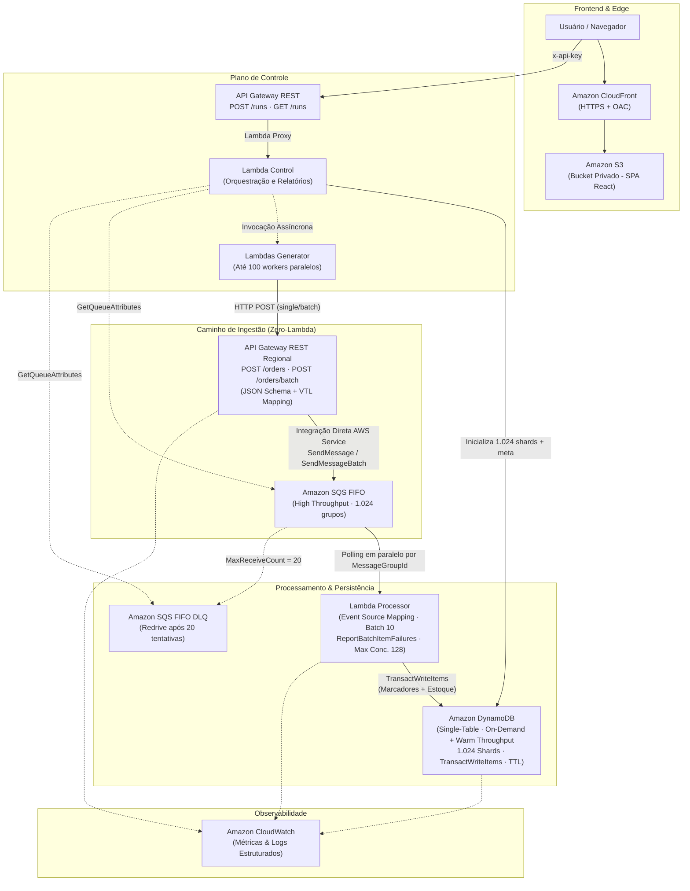
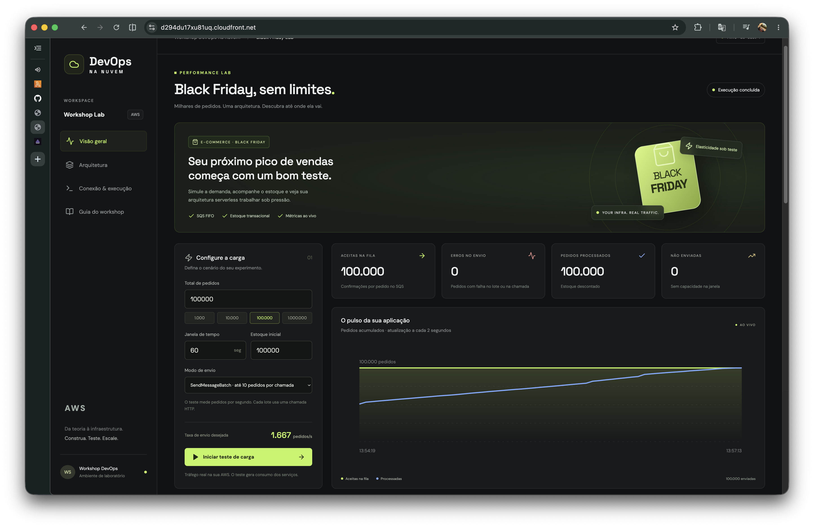
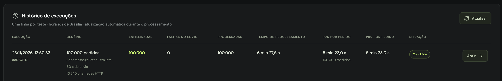

# Black Friday Lab — Arquitetura Serverless de Alta Escala na AWS

Simulador de e-commerce serverless projetado para suportar picos de carga, de 1 milhão de pedidos por minuto, estilo Black Friday — da ingestão de milhares de requisições por segundo até a baixa transacional e idempotente de estoque, com **zero perda de pedidos** e **DLQ zerada**.

> **Contexto & Transparência:** Este projeto foi implementado durante o workshop **DevOps na Nuvem**. O objetivo prático deste laboratório foi **arquitetar, provisionar, integrar, dimensionar, ajustar limites e diagnosticar toda a infraestrutura na AWS** — demonstrando na prática como os conceitos da certificação **AWS Certified Solutions Architect – Associate (SAA-C03)** se traduzem em decisões de engenharia no mundo real.

---

## Sumário

- [Visão Geral do Desafio](#visão-geral-do-desafio)
- [Arquitetura da Solução](#arquitetura-da-solução)
- [Serviços AWS e Configurações-Chave](#serviços-aws-e-configurações-chave)
- [AWS Solutions Architect Associate (SAA-C03) na Prática](#aws-solutions-architect-associate-saa-c03-na-prática)
- [Decisões Arquiteturais e Trade-offs](#decisões-arquiteturais-e-trade-offs)
- [Matemática de Capacidade e Escala](#matemática-de-capacidade-e-escala)
- [Dashboard e Evidências de Execução](#dashboard-e-evidências-de-execução)
- [Como Executar Localmente e Testar](#como-executar-localmente-e-testar)
- [Roadmap](#roadmap)

---

## Visão Geral do Desafio

Em eventos de pico como uma Black Friday, um sistema de pedidos precisa lidar com três problemas clássicos de sistemas distribuídos:

1. **Absorver rajadas extremas de entrada** (ex.: até **1.000.000 de pedidos em 60 segundos**, ou ~16.667 pedidos/s) sem rejeitar clientes por lentidão do banco de dados.
2. **Garantir consistência de estoque sem *race conditions***, evitando vender mais itens do que o disponível mesmo sob alta concorrência.
3. **Ser resiliente a falhas transitórias e reentregas**, garantindo que um mesmo pedido nunca desconte o estoque duas vezes (idempotência).

Neste laboratório, em vez de alterar o código da aplicação, alteramos **exclusivamente variáveis de infraestrutura na AWS** (throttling do API Gateway, modo de throughput do SQS FIFO, concorrência máxima do Event Source Mapping e capacidade do DynamoDB) para observar o impacto real em métricas e logs — validando que, em alta escala, **a arquitetura e os limites dos serviços definem se o sistema aguenta o pico ou cai**.

---

## Arquitetura da Solução

A arquitetura separa claramente o **plano de controle** (iniciar testes e consultar histórico), o **caminho de ingestão** (aceitar pedidos rapidamente direto na fila) e o **caminho de processamento** (drenar a fila em paralelo e abater estoque de forma transacional).



### Fluxo ponta a ponta

1. **Entrega do painel:** O **CloudFront** distribui o painel React hospedado em um bucket **S3 privado** usando **Origin Access Control (OAC)**. O tráfego de carga dos pedidos não passa pelo CloudFront.
2. **Inicialização da execução (`POST /runs`):** A **Lambda Control** grava os metadados do teste e inicializa **1.024 partições lógicas (shards)** de estoque no **DynamoDB**, distribuindo o saldo total entre elas. Em seguida, dispara as **Lambdas Generator** de forma assíncrona com um horário comum de início.
3. **Ingestão sem Lambda (`POST /orders` e `POST /orders/batch`):** As geradoras enviam pedidos (individuais ou em lotes de até 10 do mesmo shard) ao **API Gateway**. O próprio Gateway valida o payload via **JSON Schema**, transforma o JSON usando **VTL (Velocity Template Language)** e publica diretamente no **SQS FIFO** (`SendMessage` ou `SendMessageBatch`), usando `MessageGroupId = runId-shard` e `MessageDeduplicationId = orderId`.
4. **Processamento paralelo e transacional:** A **Lambda Processor** consome a fila em lotes de até 10 mensagens. Grupos FIFO diferentes avançam em paralelo (até o limite de `Maximum Concurrency`), enquanto mensagens do mesmo grupo mantêm ordem estrita. Em uma única transação (`TransactWriteItems`), a função grava os marcadores de idempotência dos pedidos e atualiza o saldo do shard correspondente no **DynamoDB**.

> **Conceito fundamental:** **`HTTP 202 Accepted` ≠ venda concluída.** O código `202` confirma apenas que o pedido foi aceito e persistido com segurança no SQS. O abatimento do estoque ocorre de forma assíncrona. Se o DynamoDB desacelerar, a fila cresce (*backlog*), mas a ingestão continua operando sem derrubar a API.

---

## Serviços AWS e Configurações-Chave

| Serviço | Papel na Arquitetura | Configurações Relevantes |
| :--- | :--- | :--- |
| **Amazon S3 + CloudFront** | Hospedagem e entrega do painel React | Bucket privado (*Block all public access*), SSE-S3, OAC com `AWS:SourceArn`, redirecionamento HTTP → HTTPS, `CachingOptimized` |
| **Amazon API Gateway (REST)** | Borda HTTP, validação, autenticação e integração direta com SQS | Endpoint Regional, API Key (`x-api-key`) + Usage Plan (Rate/Burst), Request Validation (JSON Schema), VTL Request/Response Mapping, CORS |
| **Amazon SQS FIFO + DLQ** | Buffer de pico (*load leveling*), ordenação por shard e deduplicação | High Throughput FIFO (`DeduplicationScope=messageGroup`, `FifoThroughputLimit=perMessageGroupId`), SSE-SQS, `VisibilityTimeout = 180 s`, Redrive para DLQ após `20` recebimentos |
| **AWS Lambda (Control)** | Orquestração de execuções e consulta de métricas/histórico | Node.js 22, 512 MB, Timeout 30 s, Lambda Proxy Integration |
| **AWS Lambda (Generator)** | Emissão distribuída de carga HTTP (até 100 workers) | Node.js 22, 1.024 MB, Timeout 660 s, `MaximumRetryAttempts = 0` na invocação assíncrona |
| **AWS Lambda (Processor)** | Consumo da fila e baixa transacional de estoque | Node.js 22, 512 MB, Timeout 30 s, Trigger SQS com `BatchSize = 10`, `ReportBatchItemFailures` ativo, `MaximumConcurrency` ajustável (até 128) |
| **Amazon DynamoDB** | Armazenamento Single-Table (metadados, shards, idempotência e histórico) | Modo **On-Demand**, chave composta (`pk`, `sk`), **Warm Throughput** pré-aquecido para picos, **TTL** de 7 dias (`ttl`), `TransactWriteItems` |
| **AWS IAM** | Controle de acesso granular entre serviços | Roles dedicadas por função/serviço seguindo **Least Privilege** (ex.: API Gateway com apenas `sqs:SendMessage` no ARN da fila) |
| **Amazon CloudWatch** | Monitoramento de métricas, throttles e logs JSON estruturados | Métricas de SQS (`ApproximateNumberOfMessagesVisible`, `ApproximateAgeOfOldestMessage`), DynamoDB (`ThrottlingReasons`), Lambda e API Gateway |

---

## AWS Solutions Architect Associate (SAA-C03) na Prática

Cada decisão técnica do laboratório mapeia diretamente para os **quatro domínios oficiais do exame SAA-C03**:

### 1. Design Secure Architectures (Segurança)
- **Proteção de origem estática (S3 + CloudFront OAC):** O bucket S3 permanece totalmente privado com *Block Public Access* ativado; apenas a distribuição CloudFront específica tem permissão `s3:GetObject` via *Bucket Policy* condicionada ao `AWS:SourceArn`.
- **IAM Least Privilege:** Cada Lambda possui uma Execution Role dedicada com permissões estritas apenas nas ações e recursos necessários (por exemplo, a `Generator` só tem `dynamodb:PutItem`; a role do API Gateway só tem `sqs:SendMessage` no ARN da fila principal, que também autoriza `SendMessageBatch`).
- **Validação na borda e criptografia em repouso:** *Request Validation* com JSON Schema (`Order` e `OrderBatch`) rejeita requisições malformadas no API Gateway antes mesmo de acionar serviços internos. Dados em repouso protegidos com SSE-S3 e SSE-SQS, e tráfego forçado via HTTPS.

### 2. Design Resilient Architectures (Resiliência)
- **Queue-Based Load Leveling:** O SQS FIFO desacopla a taxa de entrada (pico de até 16.667 pedidos/s) da taxa de consumo do banco de dados, evitando falhas em cascata.
- **Visibility Timeout calibrado (`6 ×` timeout da Lambda):** Configurado em **180 s** para uma Lambda Processor com timeout de **30 s**, seguindo a recomendação oficial da AWS para dar margem a retries em caso de throttling sem causar reentrega prematura.
- **Tratamento de falhas parciais (`ReportBatchItemFailures`):** Se a 4ª mensagem de um lote de 10 falhar no DynamoDB, a Processor retorna a 4ª e todas as seguintes em `batchItemFailures`. O SQS remove com segurança as 3 primeiras já processadas e preserva a ordem FIFO das restantes.
- **Idempotência ponta a ponta:** Combinação de `MessageDeduplicationId = orderId` no SQS FIFO (janela de 5 min) + marcadores persistentes no DynamoDB com `ConditionExpression: attribute_not_exists(pk)` e *optimistic locking* (`#remaining = :expected`) dentro da mesma `TransactWriteItems`. Mesmo que uma mensagem seja reentregue após 5 minutos, o estoque jamais é descontado duas vezes.
- **Dead-Letter Queue (DLQ):** Mensagens que excedem 20 tentativas vão para a DLQ FIFO para inspeção e reprocessamento controlado, sem travar a fila principal.

### 3. Design High-Performing Architectures (Performance)
- **Storage-First / Service Integration (API Gateway → SQS sem Lambda):** Remover a Lambda da rota de ingestão elimina *cold starts*, reduz latência, corta custos e preserva a quota regional de concorrência Lambda da conta para os workers e consumidoras.
- **High Throughput FIFO:** Ativar `DeduplicationScope = messageGroup` e `FifoThroughputLimit = perMessageGroupId` quebra o limite padrão de 300 msg/s da fila FIFO e escala o throughput proporcionalmente aos **1.024 `MessageGroupId`s**.
- **Batching no produtor e no consumidor:** Enviar até 10 pedidos do mesmo shard por chamada (`SendMessageBatch`) reduz em ~10× o número de requisições no API Gateway (~100 mil chamadas HTTP para 1 milhão de pedidos) e maximiza o aproveitamento dos lotes de 10 na Processor.
- **Write Sharding no DynamoDB:** Em vez de um único item de estoque (limitado a ~1.000 WCU/s por partição física), o saldo é dividido em **1.024 itens com Partition Keys distintas** (`${runId}#SHARD#${shard}`), distribuindo a escrita por múltiplas partições físicas.
- **DynamoDB Warm Throughput:** Pré-aquece a tabela On-Demand antes de testes massivos para suportar picos instantâneos no segundo zero, sem aguardar o tempo de *partition splitting* sob demanda.

### 4. Design Cost-Optimized Architectures (Otimização de Custos)
- **Serverless *Pay-per-Use*:** Custo próximo de zero quando não há testes rodando, sem instâncias EC2 ou clusters de banco ociosos.
- **DynamoDB TTL (Time to Live):** Itens temporários de teste (metadados, shards, métricas de workers e marcadores de idempotência) expiram automaticamente após **7 dias** sem consumir unidades de escrita (WRU).
- **Redução de invocações por Batching:** Agrupar 10 pedidos por chamada reduz drasticamente custos por requisição no API Gateway, SQS e Lambda.
- **Governança de Warm Throughput:** Como aumentar o Warm Throughput do DynamoDB gera cobrança única e **não pode ser reduzido posteriormente**, os cenários didáticos de gargalo de banco utilizam o limite reversível `MaxWriteRequestUnits` (teto on-demand) em vez de alterar o warm da stack principal.

---

## Decisões Arquiteturais e Trade-offs

Em arquitetura de soluções não existe "bala de prata" — toda escolha envolve compromissos. Abaixo estão os principais trade-offs deste desenho:

| Decisão | Alternativa Descartada | Por que escolhemos | Trade-off / O que abrimos mão |
| :--- | :--- | :--- | :--- |
| **API Gateway → SQS Direto (VTL)** | API Gateway → Lambda → SQS | Menor latência, zero *cold start*, menor custo e economia da quota de concorrência Lambda da conta durante picos. | Templates VTL são mais verbosos e difíceis de testar/depurar; a borda fica limitada a validações declarativas (JSON Schema), sem lógica de negócio complexa. |
| **Processamento Assíncrono (`202 Accepted`)** | Baixa síncrona no checkout (`200 OK`) | Isola a experiência de entrada do ritmo do banco; absorve rajadas de 16.667 pedidos/s sem falhas em cascata. | **Consistência eventual** para o cliente: a confirmação definitiva de estoque acontece depois (na drenagem da fila), exigindo notificação/polling posterior em um e-commerce real. |
| **SQS FIFO (High Throughput)** | SQS Standard | Garante ordem por shard (`runId-shard`), deduplicação nativa de 5 min e evita duas consumidoras disputando o mesmo registro de estoque ao mesmo tempo. | Custo unitário um pouco maior que Standard; exige modelar bem a cardinalidade de grupos (1.024) e implementar `ReportBatchItemFailures` respeitando a ordem do grupo. |
| **Write Sharding (1.024 shards de estoque)** | Item único de estoque por produto | Permite ultrapassar o limite de 1.000 WCU/s por partição física do DynamoDB e habilita alto paralelismo nas consumidoras. | **Fragmentação de saldo:** um shard pode zerar enquanto outro ainda tem unidades (em produção, exige rebalanceamento ou *fallback* entre shards) e a leitura do saldo total exige consultar os 1.024 itens. |
| **DynamoDB On-Demand + Warm Throughput** | Provisioned Capacity + Auto Scaling | Acompanha picos súbitos (0 → 16.000+ WRU/s) sem pagar por capacidade provisionada ociosa fora do evento. | Preço unitário por WRU/RRU mais alto em carga constante e previsível; aumento de Warm Throughput tem cobrança única e é irreversível. |
| **Backpressure Controlado (`Max Concurrency` + teto 96 WRU/s)** | Deixar a Lambda escalar sem limite | Evita tempestade de *throttling* no DynamoDB, reduz retries e garante drenagem estável com **DLQ = 0**. | Aumenta o tempo total de drenagem da fila (~4 min 20 s para 1 milhão de pedidos com 128 concorrências). |

---

## Matemática de Capacidade e Escala

Um dos grandes aprendizados práticos do workshop é **fazer a conta de capacidade antes de disparar a carga**:

- **Custo de escrita por transação no DynamoDB:** Um lote cheio com 10 pedidos executa `TransactWriteItems` com **11 itens** (10 `Put` de marcadores de idempotência + 1 `Update` no shard de estoque). Como cada item em transação consome **2 WRUs**, um lote cheio custa **22 WRUs** → média de **2,2 WRU/pedido**.
- **Teto teórico com a configuração de referência:**
  - Cada invocação da Lambda Processor respeita um orçamento de **96 WRU/s** (aplicado por *pacing* no código).
  - Com `Maximum Concurrency = 128`, o orçamento máximo de escrita é `128 × 96 = 12.288 WRU/s` (com Warm Throughput configurado em 16.000 WRU/s para folga).
  - Teto teórico de consumo com lotes cheios: `12.288 ÷ 2,2 ≈ 5.585 (~5.600) pedidos/s`.
- **Referência de escala (1.000.000 de pedidos em 60 s):**
  - 50 workers enviando em lote (`SendMessageBatch`) → **100.352 chamadas HTTP** na janela de 60 s (~16.667 pedidos/s de entrada).
  - Resultado de referência: **1.000.000 aceitos**, **0 erros de envio**, **0 DLQ**, processamento concluído em **4 min 20 s**.

---

## Dashboard e Evidências de Execução

O painel web (hospedado no **S3 + CloudFront**) permite configurar o cenário de carga, acompanhar a ingestão e a drenagem da fila em tempo real e consultar o histórico completo das execuções com latências P95 e P99.

### Execução de teste em tempo real (100.000 pedidos em 60 s)

Visualização da aba **Visão geral** ao final de um teste de **100.000 pedidos** enviados em lotes (`SendMessageBatch`, até 10 pedidos por chamada) com **0 erros no envio** e **100.000 pedidos processados**. No gráfico *O pulso da sua aplicação*, é possível observar o desacoplamento clássico do *Queue-Based Load Leveling*: a linha verde (**Aceitas na fila**) atinge os 100.000 pedidos rapidamente, enquanto a linha azul (**Processadas**) drena o estoque de forma constante e controlada.



### Histórico de processamentos

Tabela de histórico consolidando métricas por execução — incluindo total enfileirado, falhas no envio, volume processado, tempo total de drenagem e percentis **P95** e **P99** por pedido (10.240 chamadas HTTP em lote para 100.000 pedidos, com 0 falhas).



---

## Como Executar Localmente e Testar

### Pré-requisitos
- **Node.js 22.18+**
- Conta AWS configurada

### 1. Build, testes e empacotamento do Backend (Lambdas)

```bash
npm --prefix backend ci
npm --prefix backend test
npm --prefix backend run build
```

Para gerar os pacotes `.zip` das três Lambdas (ex.: no macOS, conforme o roteiro):

```bash
cd backend && npm prune --omit=dev && cd dist
/usr/bin/tar -a -cf lambda-controller.zip lambda-controller shared -C .. package.json node_modules
/usr/bin/tar -a -cf lambda-generator.zip lambda-generator shared -C .. package.json node_modules
/usr/bin/tar -a -cf lambda-processor.zip lambda-processor shared -C .. package.json node_modules
```

### 2. Executar ou compilar o Painel React

```bash
npm --prefix site ci
npm --prefix site run dev
```

Na aba de conexão do painel, informe a URL do stage do seu API Gateway (ex.: `.../live`) e a API Key (`x-api-key`). Para gerar os arquivos estáticos destinados ao bucket S3:

```bash
npm --prefix site run build
# Saída gerada em site/dist/
```

---

## Roadmap

- [x] Provisionamento e validação ponta a ponta da arquitetura serverless na AWS (API Gateway + SQS FIFO + Lambda + DynamoDB + S3/CloudFront).
- [x] Testes de carga com métricas em tempo real, histórico de execuções e validação de resiliência (**0 erros no envio** e **DLQ zerada**).
- [ ] **Próximo passo — Infraestrutura como Código (IaC) com Terraform:** Automatizar e versionar todo o provisionamento da infraestrutura AWS com **Terraform** (S3 + CloudFront OAC, API Gateway REST com VTL e JSON Schema, SQS FIFO + DLQ, funções Lambda + Event Source Mapping, DynamoDB e IAM Roles com *Least Privilege*), tornando o ambiente reproduzível e fácil de subir/destruir com um único comando.

