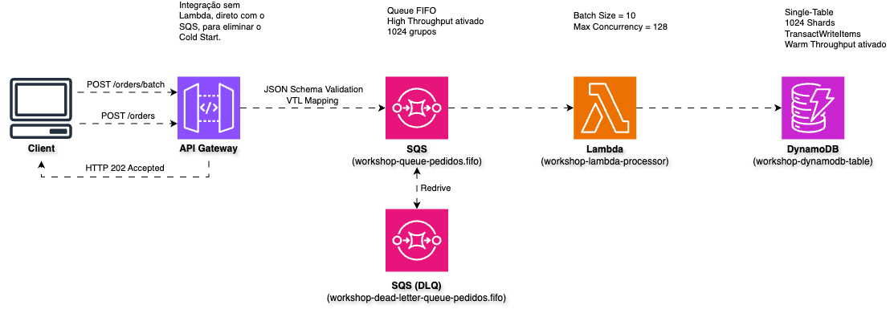
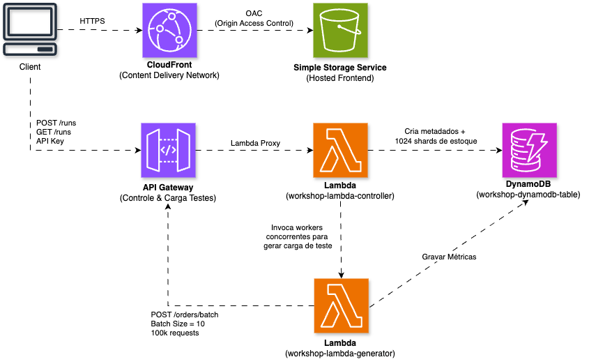
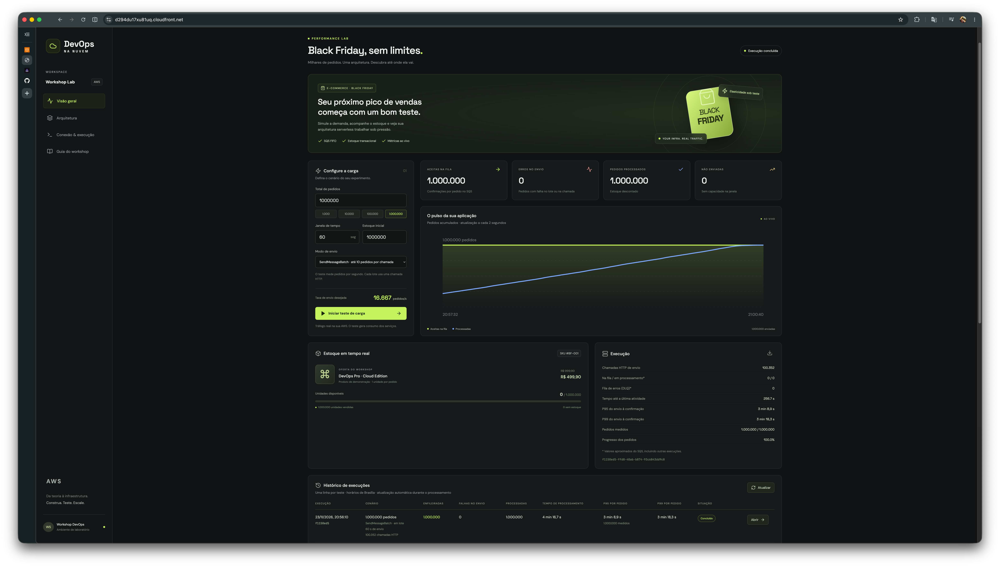

# Black Friday Lab — Arquitetura Serverless de Alta Escala na AWS

Simulador de e-commerce serverless projetado para suportar picos de carga, de 1 milhão de pedidos por minuto, estilo Black Friday — da ingestão de milhares de requisições por segundo até a baixa transacional e idempotente de estoque, com **zero perda de pedidos** e **DLQ zerada**.



---

## Sumário

- [Visão Geral do Desafio](#visão-geral-do-desafio)
- [Arquitetura da Solução](#arquitetura-da-solução)
- [Serviços AWS e Configurações-Chave](#serviços-aws-e-configurações-chave)
- [Decisões Técnicas](#decisões-técnicas)
- [Matemática de Capacidade e Escala](#matemática-de-capacidade-e-escala)
- [Dashboard e Evidências de Execução](#dashboard-e-evidências-de-execução)
- [Como Executar Localmente e Testar](#como-executar-localmente-e-testar)
- [Roadmap](#roadmap)

---

## Visão Geral do Desafio

Em eventos de pico como uma Black Friday, um sistema de pedidos precisa lidar com três problemas clássicos de sistemas distribuídos:

1. **Absorver rajadas extremas de entrada** (ex.: até **1.000.000 de pedidos em 60 segundos**, ou ~16.667 pedidos/s) sem rejeitar clientes por lentidão do banco de dados.
2. **Garantir consistência de estoque sem *race conditions***, evitando vender mais itens do que o disponível mesmo sob alta concorrência.
3. **Ser resiliente a falhas transitórias e reentregas**, garantindo que um mesmo pedido nunca desconte o estoque duas vezes (idempotência).

Neste laboratório, em vez de alterar o código da aplicação, alteramos **exclusivamente variáveis de infraestrutura na AWS** (throttling do API Gateway, modo de throughput do SQS FIFO, concorrência máxima do Event Source Mapping e capacidade do DynamoDB) para observar o impacto real em métricas e logs — validando que, em alta escala, **a arquitetura e os limites dos serviços definem se o sistema aguenta o pico ou cai**.

---

## Arquitetura da Solução

A arquitetura separa claramente o **plano de controle e frontend** (entregar o painel, iniciar testes, disparar carga e consultar métricas), o **caminho de ingestão** (aceitar pedidos rapidamente direto na fila) e o **caminho de processamento** (drenar a fila em paralelo e abater estoque de forma transacional).

### Frontend, Plano de Controle e Geração de Carga

Enquanto o diagrama no topo ilustra o fluxo crítico de ingestão e processamento de pedidos (`/orders`), o diagrama abaixo mostra como o painel web é entregue via **CloudFront + S3 (OAC)** e como o plano de controle (`/runs`) orquestra os workers concorrentes de carga:



### Fluxo ponta a ponta

1. **Entrega do painel:** O **CloudFront** distribui o painel React hospedado em um bucket **S3 privado** usando **Origin Access Control (OAC)**. O tráfego de carga dos pedidos não passa pelo CloudFront.
2. **Inicialização da execução (`POST /runs`):** A **Lambda Control** grava os metadados do teste e inicializa **1.024 partições lógicas (shards)** de estoque no **DynamoDB**, distribuindo o saldo total entre elas. Em seguida, dispara as **Lambdas Generator** de forma assíncrona com um horário comum de início.
3. **Ingestão sem Lambda (`POST /orders` e `POST /orders/batch`):** As geradoras enviam pedidos (individuais ou em lotes de até 10 do mesmo shard) ao **API Gateway**. O próprio Gateway valida o payload via **JSON Schema**, transforma o JSON usando **VTL (Velocity Template Language)** e publica diretamente no **SQS FIFO** (`SendMessage` ou `SendMessageBatch`), usando `MessageGroupId = runId-shard` e `MessageDeduplicationId = orderId`.
4. **Processamento paralelo e transacional:** A **Lambda Processor** consome a fila em lotes de até 10 mensagens. Grupos FIFO diferentes avançam em paralelo (até o limite de `Maximum Concurrency`), enquanto mensagens do mesmo grupo mantêm ordem estrita. Em uma única transação (`TransactWriteItems`), a função grava os marcadores de idempotência dos pedidos e atualiza o saldo do shard correspondente no **DynamoDB**.

> **Conceito fundamental:** **`HTTP 202 Accepted` ≠ venda concluída.** O código `202` confirma apenas que o pedido foi aceito e persistido com segurança no SQS. O abatimento do estoque ocorre de forma assíncrona. Se o DynamoDB desacelerar, a fila cresce (*backlog*), mas a ingestão continua operando sem derrubar a API.

---

## Serviços AWS e Configurações-Chave

| Serviço | Papel na Arquitetura | Configurações Relevantes |
| :--- | :--- | :--- |
| **Amazon S3 + CloudFront** | Hospedagem e entrega do painel React | Bucket privado (*Block all public access*), SSE-S3, OAC com `AWS:SourceArn`, redirecionamento HTTP → HTTPS, `CachingOptimized` |
| **Amazon API Gateway (REST)** | Borda HTTP, validação, autenticação e integração direta com SQS | Endpoint Regional, API Key (`x-api-key`) + Usage Plan (Rate/Burst), Request Validation (JSON Schema), VTL Request/Response Mapping, CORS |
| **Amazon SQS FIFO + DLQ** | Buffer de pico (*load leveling*), ordenação por shard e deduplicação | High Throughput FIFO (`DeduplicationScope=messageGroup`, `FifoThroughputLimit=perMessageGroupId`), SSE-SQS, `VisibilityTimeout = 180 s`, Redrive para DLQ após `20` recebimentos |
| **AWS Lambda (Control)** | Orquestração de execuções e consulta de métricas/histórico | Node.js 22, 512 MB, Timeout 30 s, Lambda Proxy Integration |
| **AWS Lambda (Generator)** | Emissão distribuída de carga HTTP (até 100 workers) | Node.js 22, 1.024 MB, Timeout 660 s, `MaximumRetryAttempts = 0` na invocação assíncrona |
| **AWS Lambda (Processor)** | Consumo da fila e baixa transacional de estoque | Node.js 22, 512 MB, Timeout 30 s, Trigger SQS com `BatchSize = 10`, `ReportBatchItemFailures` ativo, `MaximumConcurrency` ajustável (até 128) |
| **Amazon DynamoDB** | Armazenamento Single-Table (metadados, shards, idempotência e histórico) | Modo **On-Demand**, chave composta (`pk`, `sk`), **Warm Throughput** pré-aquecido para picos, **TTL** de 7 dias (`ttl`), `TransactWriteItems` |
| **AWS IAM** | Controle de acesso granular entre serviços | Roles dedicadas por função/serviço seguindo **Least Privilege** (ex.: API Gateway com apenas `sqs:SendMessage` no ARN da fila) |
| **Amazon CloudWatch** | Monitoramento de métricas, throttles e logs JSON estruturados | Métricas de SQS (`ApproximateNumberOfMessagesVisible`, `ApproximateAgeOfOldestMessage`), DynamoDB (`ThrottlingReasons`), Lambda e API Gateway |

---

## Decisões Técnicas

Em arquitetura de soluções não existe "bala de prata" — toda escolha envolve compromissos. Abaixo estão os principais trade-offs do desenho e os pilares complementares aplicados na infraestrutura:

| Decisão | Alternativa Descartada | Por que escolhemos | Trade-off / O que abrimos mão |
| :--- | :--- | :--- | :--- |
| **API Gateway → SQS Direto (VTL)** | API Gateway → Lambda → SQS | Menor latência, zero *cold start*, menor custo e economia da quota de concorrência Lambda da conta durante picos. | Templates VTL são mais verbosos e difíceis de testar/depurar; a borda fica limitada a validações declarativas (JSON Schema), sem lógica de negócio complexa. |
| **Processamento Assíncrono (`202 Accepted`)** | Baixa síncrona no checkout (`200 OK`) | Isola a experiência de entrada do ritmo do banco; absorve rajadas de 16.667 pedidos/s sem falhas em cascata. | **Consistência eventual** para o cliente: a confirmação definitiva de estoque acontece na drenagem da fila, exigindo notificação/polling posterior em um e-commerce real. |
| **SQS FIFO (High Throughput)** | SQS Standard | Garante ordem por shard (`runId-shard`), deduplicação nativa de 5 min e evita duas consumidoras disputando o mesmo registro de estoque ao mesmo tempo. | Custo unitário um pouco maior que Standard; exige modelar bem a cardinalidade de grupos (1.024) e implementar `ReportBatchItemFailures` respeitando a ordem do grupo. |
| **Write Sharding (1.024 shards de estoque)** | Item único de estoque por produto | Permite ultrapassar o limite de 1.000 WCU/s por partição física do DynamoDB e habilita alto paralelismo nas consumidoras. | **Fragmentação de saldo:** um shard pode zerar enquanto outro ainda tem unidades (em produção, exige rebalanceamento ou *fallback*) e a leitura total consulta os 1.024 itens. |
| **DynamoDB On-Demand + Warm Throughput** | Provisioned Capacity + Auto Scaling | Acompanha picos súbitos (0 → 16.000+ WRU/s) sem pagar por capacidade provisionada ociosa fora do evento. | Preço unitário por WRU/RRU mais alto em carga constante; aumento de Warm Throughput gera cobrança única e é irreversível. |
| **Backpressure Controlado (`Max Concurrency` + teto 96 WRU/s)** | Deixar a Lambda escalar sem limite | Evita tempestade de *throttling* no DynamoDB, reduz retries e garante drenagem estável com **DLQ = 0**. | Aumenta o tempo total de drenagem da fila (~4 min 17 s para 1 milhão de pedidos com 128 concorrências). |

### Pilares Complementares

- **Segurança:** Bucket S3 privado com *Block Public Access* acessível apenas pelo CloudFront via **OAC** (`AWS:SourceArn`); **IAM Least Privilege** com roles dedicadas por função/serviço; validação de payload na borda (**JSON Schema**) e criptografia em trânsito (HTTPS) e em repouso (SSE-S3 / SSE-SQS).
- **Resiliência e Idempotência:** `VisibilityTimeout` de **180 s** (`6 ×` timeout da Lambda de 30 s) para margem segura de retries; **`ReportBatchItemFailures`** para reprocessar apenas a partir da mensagem que falhou preservando a ordem FIFO; idempotência ponta a ponta combinando `MessageDeduplicationId` no SQS + marcadores condicionais (`attribute_not_exists`) e *optimistic locking* dentro da `TransactWriteItems`; **DLQ FIFO** após 20 tentativas.
- **Performance:** **Batching 10×** no produtor (`SendMessageBatch` — ~100 mil chamadas HTTP para 1 milhão de pedidos) e no consumidor (`BatchSize = 10`), somado ao **High Throughput FIFO** (`perMessageGroupId`) escalando em paralelo pelos 1.024 grupos.
- **Otimização de Custos:** Arquitetura 100% *pay-per-use* (custo próximo de zero ociosa), **DynamoDB TTL** de 7 dias para expirar dados de teste sem consumir WRU, e uso do limite reversível `MaxWriteRequestUnits` para simular gargalos sem alterar o Warm Throughput principal.

---

## Matemática de Capacidade e Escala

Em arquiteturas serverless de alta escala, é fundamental **fazer a conta de capacidade antes de disparar a carga**:

- **Custo de escrita por transação no DynamoDB:** Um lote cheio com 10 pedidos executa `TransactWriteItems` com **11 itens** (10 `Put` de marcadores de idempotência + 1 `Update` no shard de estoque). Como cada item em transação consome **2 WRUs**, um lote cheio custa **22 WRUs** → média de **2,2 WRU/pedido**.
- **Teto teórico com a configuração de referência:**
  - Cada invocação da Lambda Processor respeita um orçamento de **96 WRU/s** (aplicado por *pacing* no código).
  - Com `Maximum Concurrency = 128`, o orçamento máximo de escrita é `128 × 96 = 12.288 WRU/s` (com Warm Throughput configurado em 16.000 WRU/s para folga).
  - Teto teórico de consumo com lotes cheios: `12.288 ÷ 2,2 ≈ 5.585 (~5.600) pedidos/s`.
- **Referência de escala (1.000.000 de pedidos em 60 s):**
  - 50 workers enviando em lote (`SendMessageBatch`) → **100.352 chamadas HTTP** na janela de 60 s (~16.667 pedidos/s de entrada).
  - Resultado obtido no laboratório: **1.000.000 aceitos**, **0 erros de envio**, **0 DLQ**, processamento concluído em **4 min 16,7 s** (P95 em **3 min 8,9 s** e P99 em **3 min 18,3 s**).

---

## Dashboard e Evidências de Execução

O painel web (hospedado no **S3 + CloudFront**) permite configurar o cenário de carga, acompanhar a ingestão e a drenagem da fila em tempo real, monitorar o abatimento do estoque e consultar o histórico completo das execuções com latências P95 e P99.

### Teste de carga: 1.000.000 de pedidos em 60 segundos

Evidência completa da execução de pico máximo (**1.000.000 de pedidos** em uma janela de **60 s** — taxa de **16.667 pedidos/s**, enviados via `SendMessageBatch` em **100.352 chamadas HTTP**):

- **Ingestão e entrega:** `1.000.000` pedidos aceitos na fila, `0` erros no envio e `0` mensagens não enviadas.
- **Processamento e consistência de estoque:** `1.000.000` pedidos processados, estoque zerado com exatidão (`0 / 1.000.000` disponíveis, `0` sem estoque) e **DLQ zerada (`0`)**.
- **Desempenho e latência:** drenagem concluída em **4 min 16,7 s** (`256,7 s`), com **P95 de 3 min 8,9 s** e **P99 de 3 min 18,3 s** (100% dos 1.000.000 de pedidos medidos).
- **Queue-Based Load Leveling em ação:** no gráfico *O pulso da sua aplicação*, a linha verde (**Aceitas na fila**) absorve o milhão de pedidos na janela de 60 s, enquanto a linha azul (**Processadas**) drena a fila de forma estável e controlada sem sobrecarregar o DynamoDB.



---

## Como Executar Localmente e Testar

### Pré-requisitos
- **Node.js 22.18+**
- Conta AWS configurada

### 1. Build, testes e empacotamento do Backend (Lambdas)

```bash
npm --prefix backend ci
npm --prefix backend test
npm --prefix backend run build
```

Para gerar os pacotes `.zip` das três Lambdas (ex.: no macOS):

```bash
cd backend && npm prune --omit=dev && cd dist
/usr/bin/tar -a -cf lambda-controller.zip lambda-controller shared -C .. package.json node_modules
/usr/bin/tar -a -cf lambda-generator.zip lambda-generator shared -C .. package.json node_modules
/usr/bin/tar -a -cf lambda-processor.zip lambda-processor shared -C .. package.json node_modules
```

### 2. Executar ou compilar o Painel React

```bash
npm --prefix site ci
npm --prefix site run dev
```

Na aba de conexão do painel, informe a URL do stage do seu API Gateway (ex.: `.../live`) e a API Key (`x-api-key`). Para gerar os arquivos estáticos destinados ao bucket S3:

```bash
npm --prefix site run build
# Saída gerada em site/dist/
```

---

## Roadmap

- [x] Provisionamento e validação ponta a ponta da arquitetura serverless na AWS (API Gateway + SQS FIFO + Lambda + DynamoDB + S3/CloudFront).
- [x] Testes de carga com métricas em tempo real, histórico de execuções e validação de resiliência (**0 erros no envio** e **DLQ zerada**).
- [ ] **Próximo passo — Infraestrutura como Código (IaC) com Terraform:** Automatizar e versionar todo o provisionamento da infraestrutura AWS com **Terraform** (S3 + CloudFront OAC, API Gateway REST com VTL e JSON Schema, SQS FIFO + DLQ, funções Lambda + Event Source Mapping, DynamoDB e IAM Roles com *Least Privilege*), tornando o ambiente reproduzível e fácil de subir/destruir com um único comando.

